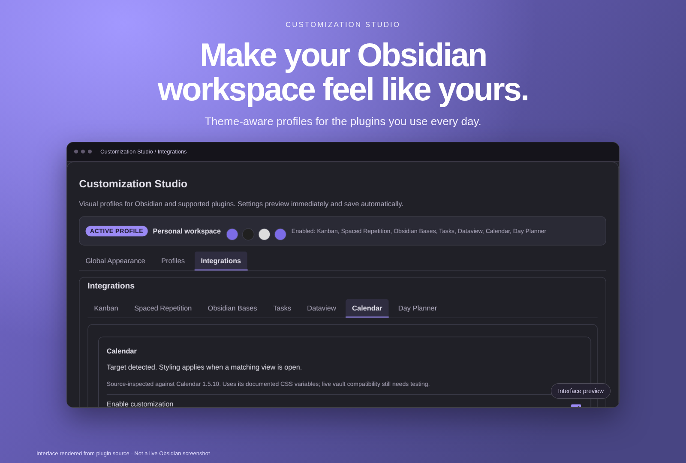

# Customization Studio



*Interface preview rendered from the plugin UI. Not a live Obsidian screenshot.*

Customization Studio is a non-invasive Obsidian plugin for personalizing the
appearance of Kanban, Spaced Repetition, Obsidian Bases, Tasks, Dataview,
Calendar, and Day Planner. It keeps module
logic separate, applies plugin-owned styles, and stores customization profiles
in the plugin folder. It does not edit target plugin sources,
settings, review schedules, Base definitions, or user content.

**Author:** [Ahmed Adel](https://github.com/Ahmedadel200066)

**Minimum Obsidian version:** 1.9.0 (required for Bases support)

## Screenshots

Screenshots are not available yet.

<!-- Add verified screenshots here after capturing them in Obsidian. -->

## Updates

Use the published release assets for updates. The `main` branch may contain
changes that have not been released yet. No new release is created by a README
or support-link update.

## Features

- Five built-in appearance presets: Minimal, Dark Academia, Glassmorphism,
  Colorful, and Focus Mode.
- A neutral, editable Default profile created from your current appearance,
  so enabling the plugin changes nothing until you adjust a setting.
- Custom profiles can be created from Default, duplicated, renamed, deleted,
  imported, exported, and switched.
- Follow Obsidian, Light, or Dark per profile, with separate Light and Dark
  values and paired preset palettes.
- A master Enabled/Paused toggle that keeps your profiles.
- Nine Bases card shapes (Standard, Book, Poster, Circle, Spine, Polaroid,
  Trading card, Disc, Ticket) with per-shape controls, artwork size, and
  optional Glow, Lift, Flip artwork, or Wiggle hover effects. Changes apply
  instantly.
- Global accent, surface, and text colors; profile-level custom CSS.
- Tab-header-only background transparency, backdrop blur, and configurable
  linear, elliptical radial, or circular radial gradients.
- A compact sticky toolbar for profiles, appearance mode, customization pause, and current-page search.
- Appearance, Plugins, and Advanced navigation with keyboard-operable tabs. Narrow settings surfaces use page and plugin dropdowns instead.
- Profile management and global custom CSS under Advanced; Manage profiles opens it directly.
- Current-page search filters settings, temporarily opens matching groups, and restores their previous state when cleared. Search is not yet cross-plugin.
- Navigation section, selected integration, and scroll position persist
  independently for the Community Plugins settings tab and ribbon modal.
- The active profile name and status are visible across sections and settings
  surfaces; profile switching updates all open views immediately.
- Basics and More settings groups keep less-used controls out of the way.
- Standard controls show Inherited or Modified, with an individual Reset button.
  Presets and forced palettes use Profile default where appropriate. Inherited
  refers to the stored profile baseline, not a live measurement of theme CSS.
  Shape options and raw CSS keep their own reset/editing tools.
- Color pickers, sliders, toggles, dropdowns, and automatic saving. Color swatches
  stay round when resizing, and enlarged Settings windows keep a readable width.
- Subtle panel and group motion respects reduced-motion preferences; keyboard
  focus and hover states stay visible.
- A ribbon shortcut opens the visual settings in a plugin-owned modal with viewport-bounded scrolling.
- A version-aware What's new dialog explains updates once, stays silent on fresh installs, and can be reopened from settings or the command palette.
- Independent module enablement and settings for each supported integration.
- Optional module-scoped custom CSS.
- Styles and observers are owned by the plugin and cleaned up when modules are
  disabled or the plugin unloads.
- Modular source architecture supports future integrations without adding
  placeholder modules to the current release.

## Network and privacy

Customization Studio has no required account, paid feature, analytics service,
or backend. Its runtime code does not upload notes or task content. Profiles,
visual settings, and custom CSS are stored locally through Obsidian's plugin
data API and a local appearance file. Exporting a profile copies its settings and CSS to your clipboard;
review them before sharing, as they may include vault-relative paths or URLs.

Network requests are optional and depend on what you configure:

- A remote Kanban background is loaded directly by your device from the
  HTTP(S) image URL you enter. The image host receives your IP address and
  ordinary request information. There is no fixed image service or proxy.
  Use a vault-local image to avoid this remote request.
- Custom CSS can also load remote resources, for example through `url()` or
  fonts. Global profile CSS can use `@import`. Module CSS rejects `@import`
  and scopes selectors, but does not block resource URLs. Selector scoping
  is not a security sandbox. Imported profiles can contain CSS and image
  URLs, so only import profiles or paste CSS from sources you trust.
- Opening the optional Ko-fi support link visits that service in
  your browser. It is not needed to use the plugin.

The runtime reads its own stylesheet in Obsidian's configuration folder and
resolves user-selected local background images inside the vault. It does not
require access to files outside the vault. It does not modify note content,
other plugins' settings, task dates, or review schedules. Obsidian's own sync
or installed extensions may handle data separately from this plugin.

## Supported integrations

### Kanban

Column/card colors and opacity, automatic and manual column coloring, spacing,
padding, radii, column blur, board image and overlay options, independent card
and column glow, and visual drag states. Local image paths are resolved through
Obsidian's vault resource-path API; external images accept HTTP(S) URLs.
Column override colors are keyed by visible title and assigned separate
temporary DOM tokens, so distinct columns remain distinct during reordering
while their DOM elements remain mounted. Overrides cannot distinguish columns
with duplicate titles, and title-based overrides do not follow a renamed
column.

The inspected selectors correspond to Kanban 2.0.51. The installed target
version and live drag interactions have not been tested in a vault. A
right-click card color menu is not provided: the inspected Kanban component
passes card IDs to its drag/drop components but does not expose a verified
stable ID on rendered card DOM; adding DOM context handlers risks interfering
with Kanban's native card menu.

### Spaced Repetition

Flashcard appearance, shared question/answer typography, review controls,
answer/review button colors and states, spacing, and transitions. The inspected
selectors correspond to Spaced Repetition 1.15.4. The inspected DOM uses shared
content rather than distinct question/answer text containers; progress styling
is not provided. Live study-session compatibility has not been tested.

### Obsidian Bases

Table and cards-view settings using documented native Bases CSS variables.
Bases is detected as an Obsidian core plugin. Some requested visual details
have no verified supported hook and are intentionally not exposed. Requires
Obsidian 1.9.0 or later.

### Tasks

Query row spacing and dividers, group headings, date metadata chips, and edit
form section spacing. Checkbox status, urgency colors, priority, validation,
and click handlers remain owned by Tasks. Source-inspected at Tasks 8.6.0,
commit `9fecdd6`; this version of Tasks requires Obsidian 1.13.1.

### Dataview

Standard result-table padding, text size, headers, alternating rows and
borders, list spacing, and inline-field surfaces. Arbitrary DataviewJS-generated
HTML is not covered. Source-inspected at Dataview 0.5.68, commit `5ad0994`.

### Calendar

Calendar text size and outer spacing, today/day/heading/dot colors, and an
optional weekend surface. Uses documented `#calendar-container` variables,
not generated Svelte class names. Source-inspected at Calendar 1.5.10,
commit `ef3f269`.

### Day Planner

Timeline background and hour separators, time-block font, corner radius,
inner content spacing, and shadow. Time positions, duration geometry, event
colors, native active borders, and drag/resize handlers are not changed.
Source-inspected at Day Planner 0.35.1, commit `9c483b3`.

The four new integrations are **off by default**, including when older
profiles load. Create an editable profile or duplicate a built-in preset, open
**Plugins**, select the target, and enable customization. Their colors follow the active theme
by default; turn off **Follow theme colors** to apply custom colors. All four
support independent settings, module-scoped CSS, profile import/export, and
cleanup on disable/unload. These source checks do not certify live-vault
behavior; the four installed target plugins still need real in-app tests.

## Installation

### Install from a GitHub release

1. Download `main.js`, `manifest.json`, and `styles.css` from the same published
   release. Put them directly into `<vault>/.obsidian/plugins/customization-studio/`.
2. Keep `data.json`, `studio-appearance.json`, and any matching backups or
   pending-save journals. Replace only the three plugin assets, then reload
   Obsidian or disable and re-enable **Customization Studio**.

Back up the plugin settings before a major update. Profiles, the active profile,
and separate Light/Dark values survive a normal update. The appearance file is
part of your saved settings, not a disposable build file. The normal profile
export includes both variants and shape settings; Legacy export does not.

When upgrading from builds that predate the Light/Dark appearance file, saved
profiles remain available, but the first migration selects a new neutral Default
and generates variant colors. Select your old profile again and check its colors.
This older migration does not guarantee an identical appearance.

Use the three standard release assets, not GitHub's automatic source-code
archive. The MIT license remains in the repository and its notice is included
in `main.js`.

### Install with BRAT

BRAT can install a repository that publishes releases containing the plugin
files. Install BRAT from Community plugins, then:

1. Open **Settings → BRAT → Add Beta plugin**.
2. Enter `Ahmedadel200066/Obsidian-Customization-Suite.` (including the final period).
3. Select the published Customization Studio release and enable it under
   Community plugins.

BRAT and release installation have not been tested in an Obsidian vault.

### Manual installation from the repository

The repository root is kept installable: it contains the generated `main.js`,
`manifest.json`, and generated `styles.css`. Clone/copy the repository contents
directly into `<vault>/.obsidian/plugins/customization-studio/`, then enable
the plugin in Obsidian. Do not copy the repository into an additional nested
folder.

## Development

Requirements: Node.js 20 or later and npm.

```sh
npm ci
npm run build
npm test
```

`npm run build` bundles `src/main.js` and local modules into the root-level
`main.js`. The Obsidian `obsidian` API remains external. The build rejects
unresolved local imports and validates the root manifest and generated stylesheet.
It copies `styles/core.css` to the standard root-level `styles.css`, which is
the runtime stylesheet distributed with the plugin. Edit the source stylesheet
and run the build rather than editing the generated copy.

To rebuild on source changes:

```sh
npm run dev
```

The workflow in `.github/workflows/release.yml` runs when a version tag is pushed,
installs locked dependencies, builds and tests the project, validates the
bundle, verifies that the tag matches manifest/package versions and versions.json,
attests `main.js`, `manifest.json`, and `styles.css` using GitHub build
provenance, and publishes those three files as the release assets. It stages the
assets in a draft and publishes only after upload. It refuses to overwrite
an already published release. Attestations are stored by GitHub, not uploaded
as additional release files.

## Compatibility and known limitations

- Minimum Obsidian version is 1.9.0 for the Bases integration.
- Kanban and Spaced Repetition selectors were inspected against upstream
  Kanban 2.0.51 and Spaced Repetition 1.15.4 source. This does not certify other
  versions.
- No live Obsidian vault or installed target plugins were available for
  validation. Real theme compatibility, restart persistence, current plugin
  DOM, and native drag/review behavior require manual testing.
- Spaced Repetition's inspected markup does not expose separate question and
  answer text containers or a verified progress bar selector.
- The documented Bases variables do not provide verified hooks for card
  radius, cover positioning, property visibility, or a specific responsive
  grid selector; those controls are omitted.
- A missing runtime `styles.css` produces a warning but does not prevent
  startup.
- The tab bar appearance targets Obsidian's `.workspace-tab-header-container`
  UI class. Zero opacity sets a transparent background without applying
  opacity to tab labels or icons. Backdrop blur is ignored by browsers that do
  not support `backdrop-filter`. Neither behavior has been verified against a
  live Obsidian window or every theme.
- The ribbon shortcut opens the shared settings UI in a plugin-owned modal;
  navigation directly to the Obsidian settings tab is not exposed through the
  public Obsidian API.
- Profile recommendations are not implemented: the inspected source contains
  no recommendation rules or theme detection, so the UI states that
  suggestions are unavailable rather than inferring a profile.
- Support is optional through the standard manifest `fundingUrl` link and the
  Ko-fi button in the What's new dialog. No integration context-menu action
  is registered because no stable, verified menu hook for the supported plugin
  views was found.
- Column blur uses a translucent lane surface (capped at 75% effective opacity
  while blur is active) so the backdrop can be visible; the exact appearance
  depends on what is behind the Kanban lane.
- External background URLs are syntactically checked but remote availability
  cannot be guaranteed or tested from the plugin settings.
- Kanban visual drag-state CSS is based on the pinned source DOM. Native
  pickup/drop behavior and visual continuity after the installed plugin
  replaces elements require live testing.
- Profile-wide custom CSS can affect any matching Obsidian element. Module CSS
  is scoped to its module root and rejects global at-rules such as `@import`.
- Licensed under MIT; see [LICENSE](LICENSE). Upstream plugins remain under
  their own licenses. This plugin does not bundle their code.

## Bug reports

Report bugs through the
[repository](https://github.com/Ahmedadel200066/Obsidian-Customization-Suite.)
Issues tab.
Include your Obsidian version, target plugin and version, steps to reproduce,
expected and actual behavior, and relevant console errors. Do not attach vault
data, private notes, or credentials.

## Contributing

Before proposing changes:

1. Check existing issues and describe the problem or feature.
2. Keep integrations isolated under `modules/<module-id>/`.
3. Verify selectors and APIs against documented or upstream sources; do not
   invent hooks.
4. Add or update tests, then run `npm ci`, `npm run build`, and `npm test`.
5. Clearly state what was and was not verified inside Obsidian.

Please do not commit secrets, user-vault content, or generated dependency
directories. Changes to licensing terms require confirmation from the project
owner. See [LICENSE](LICENSE) for the current MIT terms.

See [bug-fix verification](BUGFIX_VERIFICATION.md), [growth-change verification](GROWTH_VERIFICATION.md), and [publishing checklist](PUBLISHING.md).

## Manual Obsidian test checklist

These checks remain necessary before claiming runtime compatibility:

1. Install the three plugin assets into `.obsidian/plugins/customization-studio/`,
   enable the plugin, and confirm the ribbon shortcut opens the settings modal.
2. Switch profiles, change global and module controls, restart Obsidian, and
   confirm settings and active profile persist.
3. Reset an individual control and confirm only that control returns to the
   current variant baseline. Check Light/Dark separately and verify the other
   profile and sibling controls remain unchanged.
4. On a Kanban 2.0.51 board, use two uniquely named columns with different
   manual colors; reorder columns and create a new lane.
5. Test a local vault image and a reachable HTTPS image as board backgrounds;
   verify a missing local path reports an error without altering board data.
6. With lane opacity below 100%, change column blur and test glow/drag styles
   during native card pickup, movement, and drop. Repeat with
   `prefers-reduced-motion` enabled.
7. Test Spaced Repetition controls in a real review and Bases controls in both
   table and cards views, including module disable and plugin unload cleanup.
8. Test Tasks, Dataview, Calendar, and Day Planner in their real views. Verify
   their native actions still work after changing styles and disabling modules.
9. Resize normal and maximized Settings windows. Check navigation, search,
   scrolling, circular color swatches, Reset, and reduced-motion behavior.

## Author

[Ahmed Adel on GitHub](https://github.com/Ahmedadel200066)

## Support

<a href="https://ko-fi.com/ahmedadel23545"></a>


If Customization Studio helps you, you can
[support Ahmed on Ko-fi](https://ko-fi.com/ahmedadel23545).
The same destination is available through the plugin details support link,
the What's new dialog, and GitHub's Sponsor button.

## Upstream references

- [Kanban](https://github.com/community-archive/obsidian-kanban), inspected
  version 2.0.51.
- [Spaced Repetition](https://github.com/st3v3nmw/obsidian-spaced-repetition),
  inspected version 1.15.4.
- [Obsidian Bases CSS variables](https://github.com/obsidianmd/obsidian-developer-docs/blob/1c26772ac13d6e9870c865936d389fdfe694e742/en/Reference/CSS%20variables/Editor/Bases.md).

- [Tasks](https://github.com/obsidian-tasks-group/obsidian-tasks), source-inspected
  for query rows, group headings, metadata chips, and edit-form spacing.
- [Dataview](https://github.com/blacksmithgu/obsidian-dataview), source-inspected
  for standard tables, lists, and inline fields.
- [Calendar](https://github.com/liamcain/obsidian-calendar-plugin), using its
  documented calendar CSS variables.
- [Day Planner](https://github.com/ivan-lednev/obsidian-day-planner), source-inspected
  for timeline and time-block styling without changing scheduling geometry.

The integration sections above record the inspected upstream versions and limits.
Upstream changes may require selector updates; these references are not a promise
of compatibility with every upstream release.
